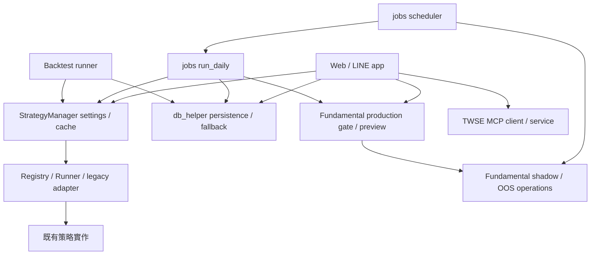

# 2026-10-14 系統架構過度設計稽核

結論：有可清理的局部重複，但平台／runtime／相容層多數有實際契約用途。先做標準庫替換與相同 records 算術集中。大模組是責任集中訊號，不宜以增加架構層次處理。

## 範圍與證據

- 盤點 tracked 檔案類型、root wrappers、Compose／manifests／execution／scheduler、現行規格與近期清理證據；追讀主要候選的實作、caller 與 tests。
- AST 掃描 app／jobs／core／services／scripts 全部 173 Python 檔／44,007 行，找出相同函式 body。Tracked Python 共 335 檔、tracked notebooks 0 個。
- 引用搜尋納入 source／test／script／docs。私有 dead-code 搜尋使用 hidden，排除虛擬環境、git、cache、outputs、data、logs 與本提案本身。未證明外部／未追蹤 operator workflow 的無引用。
- 依據 dirty tree 和當日 shadow preview change；不覆寫使用者修改。未讀 .env、未寫出 secrets／settings 值、未操作正式 DB／排程／LINE push／容器。

## Ponytail audit：按可估算刪減排序

native: 六份串流 SHA-256 迴圈改用 `hashlib.file_digest(handle, "sha256").hexdigest()`，保留 binary with、signature 和各自 OSError 行為。函式區塊可少 18 行，須先盤點 frozen source-hash consumers。[jobs/run_factor_validation.py:67; core/research/fundamental_factor_validation.py:115; core/runtime/fresh_oos_promotion.py:49; core/runtime/fundamental_advancement.py:42; core/research/universe_recovery.py:237; core/research/fundamentals/pit.py:601]

shrink: F2／V3 的 `_record_dict` 18 行完全相同，未來可由既有 PIT owner 提供明確 serializer，保留 CLI 欄位與日期格式；本次 DEFER，先確認 evidence bytes／source hashes，避免為小重複新建框架。[jobs/run_fundamental_pit_f2.py:66; jobs/run_fundamental_pit_v3.py:95]

delete: `_freeze_mapping` 9 行，hidden search 只見定義；replacement: nothing。補完 deletion_candidates.md 動態／外部引用證據才刪。[core/strategy/spec.py:35]

shrink: Dashboard／LINE 重算同樣的 rising／falling／flat／volume 與逐筆轉 int 法人總和；在既有 dashboard_payloads 加最多兩個小純函式共用，保留取資料／日期／cache／empty／error／輸出；尚未預報淨行數。[app/dashboard_payloads.py:107; app/dashboard_payloads.py:159; app/line_flows.py:620; app/line_flows.py:661]

net: -27 lines, -0 deps possible.

這是條件式 audit 候選區塊估算，非已完成節省：四個 6 行 hash → 3 行（12），兩個 9 行 hash → 6 行（6），dead helper 9 行，共 27。Phase 2 與 DEFER serializer 不計入，未包含新增驗證／文件；引用或凍結證據不允許時減幅縮小。這個估算與 gain 卡的 benchmark 無關。

## 架構 ownership



這是相關 ownership 摘要，不表示每條 Web／LINE 流程都進 Runner，也不表示 eligibility 自動啟用交易。

| 元件 | 決策 | 證據／最小後續 |
|---|---|---|
| StrategyManager／Registry／Runner／LegacyStrategyAdapter | KEEP | Daily:833、Backtest runner:510、Rich Menu／extensibility tests；settings／selection 各有 owner，保留 protocol／adapter |
| v3x alias／research re-export | KEEP | 舊 key、公共 import 與歷史 DB 值受相容契約保護 |
| app.py／config.py／4_run_backtest.py／5_push_to_line.py | KEEP | CLI／batch／test 與公共相容面；單一委派不等於無用 |
| app services composition seam | KEEP | tests patch app symbols；2026-10-07 已移除舊 sys.modules 查找，不重建 DI |
| db_helper.py（2,665 行） | DEFER | pipeline state／DB cache／fallback／financial supplement／atomic persistence 都有 caller；先找特定重複，不建立 repository 層 |
| dashboard_payloads.py（1,642 行）、web_server.py（1,432 行） | tested consolidation | 本次只共用與 LINE 相同算術；history／war-room／LLM cache 大拆檔另案 |
| run_daily.py（1,075 行） | DEFER | indicators／financial／revenue／selection／heartbeat／persistence／dry-run 有 parity；不改泛用 pipeline DSL |
| 多份 `_freeze` | KEEP | strategy／runtime 支援 Mapping／set／tuple；shadow 只凍結 JSON dict／list、不凍結 keys，語意不同 |
| V30_PARAMS lazy dict proxy | KEEP | app:499、Backtest:531／545 動態讀取 class attributes；常數 dict 會改行為 |
| 多份 JSON writers | KEEP | newline／sort_keys／numpy default／dict coercion／digest return 有差異 |
| MCP DTO 相同 methods | DEFER | public dataclass 與 validation 是 transport boundary；inheritance 省小量行但增加契約風險 |
| runtime／MCP manifests | KEEP | Compose 已採獨立依賴，無須重做 |
| requirements.txt broad freeze | UNKNOWN | 2026-10-07 ownership 未具完整移除證據；torch／gym／selenium 等靜態 no-import 不等於無用，本次可證實刪除依賴為 0 |
| Compose 啟動 pip install | DEFER | 當日 restart design 已列映像預建後續；部署另案，不混入架構算術清理 |

不同算術反例：Web `_build_institutional_totals` 是 `int(sum(...))`，LINE／snapshot 是 `sum(int(...))`；遇到小數結果不同。Web market light 的缺值與分母也不同，不跨三條路徑統一公式。

## Ponytail debt：只讀台帳

jobs/update_database.py:394，簡化：空的成功來源回應視作休市。ceiling：沒有權威台灣交易日曆確認。upgrade：有權威日曆時使用它確認。trigger 已命名。

scripts/ci_check_integration_marker_coverage.py:3（續至第 8 行），簡化：test file 完全沒有 DB isolation signals 才標記。ceiling：file-level heuristic 會漏報部分 MySQL-dependent tests。upgrade：有 unmarked／unmocked MySQL test 漏網時擴大 heuristic。trigger 已命名。

2 markers, 0 with no trigger.

第二筆標記實際位於 module docstring，第一筆是 Python COMMENT token；文字慣例掃描仍列出兩筆，不將技能说明或本提案正文計入程式 debt。沒有另寫全域 ledger。

## Ponytail gain：技能提供的 benchmark

```text
ponytail gain          benchmark median: 5 tasks, 3 models

Lines  no-skill  ####################  100%
       ponytail #---................    6-20%  down 80-94%
Cost   no-skill  ####################  100%
       ponytail #####------.........   23-53%  down 47-77%
Speed  ponytail  3-6x faster
```

來源為 ponytail-gain 技能提供的 benchmarks／README 數字；本回合未重跑 benchmark。這不是本 repo 實測，不作 tokens／成本節省承諾。實作後以真實 diff／測量報告實際變化。

## 一般正確性檢視前置項

初步 suite 為 125 passed／1 failed。LINE postback test patch app facade，但 `app.line_bot.reply_message` 使用直接匯入的 SDK 型別；ReplyMessageRequest 收到字串測試訊息而 validation failure。單測重跑仍失敗；這是既有 correctness 問題，須另行修復，不能以刪 adapter、削除 validation 或忽略測試處理。詳見 verification.md。尚未完成 full suite 或線上服務全面驗證。